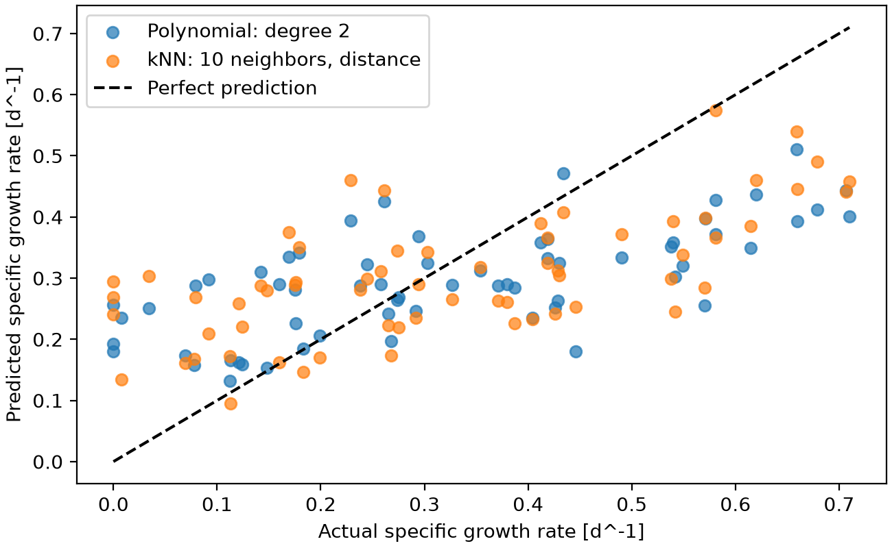
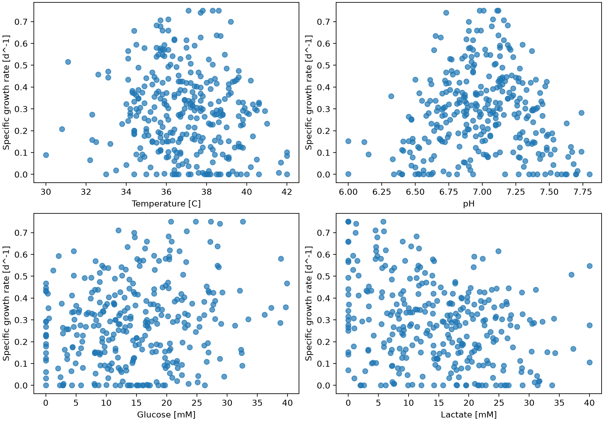

# Cell Growth Prediction

This project predicts the specific growth rate of cells from environmental and metabolic conditions like temperature, pH, nutrient availability, and the accumulation of metabolic byproducts using a simulated dataset. It compares linear, polynomial, and k-nearest neighbors regression, selects model settings through cross validation, and evaluates predictions on test data. The results help identify growth patterns and the limits of predicting growth from these four inputs.

## Highlights

- Predict growth from four culture conditions
- Compare polynomial regression and kNN models
- Optimize settings using cross validation
- Evaluate predictions on a reserved test set
- Export results as tables and figures

## Environment

- Python: 3.14.7
- matplotlib: 3.11.0
- numpy: 2.5.2
- pandas: 3.0.5
- scikit-learn: 1.9.0

## Code Design

### Loading and inspecting the dataset

The program starts in `main.py` and ra pandaseads `datasets/dataset_cell_growth_4factor.csv` into  DataFrame. It prints the first five rows, the table dimensions, the column types, and the number of missing values in each column. These check that the expected file was loaded and that its contents are suitable for regression. The dataset contains observations and numeric columns. All columns have complete values, so the models can use the observations without filling missing entries. Inspecting the data first also makes errors in column names or file placement easier to identify.

### Selecting inputs and reserving test observations

The four process variables are chosen to be `X`, and specific growth rate is chosen to be `y`. Explicit column names identify the target correctly, even though growth rate is the first column in the CSV. Each input row stays paired with its corresponding growth rate. The program then reserves 20% of the observations for testing using `train_test_split` with `random_state=0`. This produces 254 training observations and 64 test observations. The split is also made reproducible by fixing the random state. Reserving the test set before model comparisons allows the final evaluation to use observations that did not influcence the choice of settings.

### Building preprocessing and regression pipelines

Three initial pipelines combine `StandardScaler` with linear regression, degree-2 polynomial regression, or kNN regression. Scaling puts the original inputs on comparable scales using the training means and standard deviations. This matters especially for kNN because its predictions depend on the distances between observations. Otherwise, variables with larger numerical ranges could dominate those distances. In the polynomial pipeline, scaling is followed by `PolynomialFeatures`, which creates powers and interactions before linear regression fits the expanded inputs. The bias column is excluded because linear regression already fits an intercept. Keeping these steps in pipelines ensures that each validation fold learns its preprocessing from its own training portion.

### Model comparisons and search settings

The initial pipelines are evaluated using fivefold cross validation on the training split. The program records training and validation RMSE and R2 scores, then prints the mean validation results. Grid searches examine polynomial degrees 1 through 5 and kNN neighbor counts 1 through 80 with both uniform and distance weighting. Each configuration is evaluated using the same fivefold arrangement and the search uses negative RMSE because scikit-learn selects the largest score. The program will convert these scores back into positive errors for interpretation. Recording training scores alongside validation scores helps identify configurations that fit their training observations well but perform poorly on held-out observations.

### Evaluating the selected configurations

Each grid search automatically fits its best configuration on the full training split. These fitted pipelines are retrieved through `best_estimator_` and used to predict growth for the 64 test observations. The program calculates test RMSE and R2 for both model families. RMSE expresses prediction error in the growth-rate units of days to the power of minus one, while R2 compares the predictions with a constant prediction equal to the test target mean. The settings are selected from cross validation before examining these test results. This final comparison checks how the selected configurations perform on a separate set of observations.

### Exporting tables and figures

The search results are organized into pandas tables and saved as `tables/polynomial_results.csv` and `tables/knn_results.csv`. The kNN table contains all 160 configurations, while the console displays its ten lowest validation errors. The program also saves `figures/test_predictions.png`, comparing both models with a perfect-prediction line. It then saves `figures/growth_relationships.png`, showing observed growth against each of the four inputs. This last figure uses the full dataset for descriptive analysis after model evaluation. The exported evidence supports the model comparison and the discussion of culture conditions. Each figure is closed after saving, and rerunning the script regenerates these outputs.

## Analysis

### Model comparison and selection

I selected kNN regression with 10 neighbors and distance weighting as the main model. It had the lowest mean validation RMSE among the configurations tested. Degree-2 polynomial regression was a close comparison, so it seems there is a preference for kNN. The comparison uses the same inputs, initial train-test split, and validation folds for both model families.

The linear baseline had a mean validation RMSE of around 0.177 and mean validation R2 of around 0.0067. Its predictions captured little of the variation within the validation folds. Nonlinear relationships improved the results, by showing degree-2 polynomial regression acheiving a validation RMSE of 0.1568, while the initial kNN model with five uniformly weighted neighbors achieved 0.1643. These results gave a reason to explore both nonlinear approaches and tune their settings instead of selecting an initial configuration immediately.

### Polynomial degree and overfitting

The polynomial search examined degrees 1 through 5. A degree-2 model includes the four original inputs, their squares, and their pairwise products, giving 14 expanded input terms. This allows curved relationships and interactions while keeping the model smaller than higher-degree alternatives.

| Degree | Mean training RMSE | Mean validation RMSE | Validation RMSE standard deviation |
|---|---:|---:|---:|
| 1 | 0.171396 | 0.176952 | 0.013039 |
| 2 | 0.142904 | 0.156807 | 0.015627 |
| 3 | 0.130027 | 0.170638 | 0.015229 |
| 4 | 0.112244 | 0.234971 | 0.058388 |
| 5 | 0.085846 | 0.618033 | 0.204829 |

*All RMSE values are in d^-1. These results are a summary. 

Training error decreased as degree increased, but validation error reached its minimum at degree 2. Beyond that point, greater flexibility fitted the training observations more closely while giving worse predictions on validation observations. Degree 5 showed this, with training RMSE of 0.0858 and validation RMSE of 0.618. Its validation scores also varied more between folds. This pattern supports choosing degree 2. Increasing degree therefore was not a useful improvement for this dataset.

### Neighbor count and weighting

The kNN search compared 160 configurations, with 80 neighbor counts and two weighting methods. Uniform weighting gives each selected neighbor the same contribution. Distance weighting gives closer neighbors more influence. Standardizing the four inputs makes this comparison meaningful across variables with different units and ranges.

| Neighbors | Weighting | Mean validation RMSE |
|---|---|---:|
| 10 | Distance | 0.154687 |
| 9 | Distance | 0.155336 |
| 11 | Distance | 0.155620 |
| 10 | Uniform | 0.155888 |

*These results are a summary. 

Ten neighbors with distance weighting had the lowest error, although nearby neighbor counts were similar. This makes 10 a reasonable choice within the tested search, but not necessarily the optimal setting. Its validation RMSE standard deviation was 0.0107, compared with 0.0156 for degree-2 polynomial regression, describing variation across these folds, not really proof that kNN is always better.

Distance-weighted kNN had zero training RMSE because a training observation can match itself at zero distance. That observation's known growth rate is then reproduced. The validation and test errors provide evidence about predictions for observations withheld from fitting.

### Final performance and prediction patterns

The selected settings were evaluated on the reserved test set without any more tuning.

| Model | Mean validation RMSE | Test RMSE | Test R2 |
|---|---:|---:|---:|
| Polynomial, degree 2 | 0.156807 | 0.157026 | 0.384134 |
| kNN, 10 neighbors, distance weighting | 0.154687 | 0.155748 | 0.394118 |

The kNN validation RMSE was about 1.35% lower than the polynomial result, and its test RMSE was about 0.81% lower, both differences being small. The similar validation and test errors show comparable performance across the evaluated splits, but a different split could change the ranking. The kNN test R2 of 0.3941 means that it explained about 39.4% of the variation in the test growth rates relative to the test-mean baseline. Considerable variation remained unexplained.

The prediction figure shows limitation for both models. Both tended to overpredict very low growth and underpredict high growth. Their predictions covered a narrower range than the actual observations. For actual growth near 0.70 d^-1, many predictions are only around 0.40 to 0.46 d^-1. This means that the average errors themselves do not fully describe performance at the extremes.

kNN can represent local relationships without specifying a global equation. Its disadvantages include sensitivity to the available neighbors and difficulty describing its predictions with a simple formula. Polynomial regression provides an explicit relationship with powers and interactions, but its form can be restrictive at low degree and its validation performance more variable at higher degree, as the results demonstrate.

### Relationships between the four inputs and growth

The temperature plot shows that many of the highest growth observations occur around 35 to 39 degrees Celsius. Growth varies substantially within this region, and the highest temperatures generally have lower growth. Temperature therefore provides useful information, but the plot does not establish an optimum or determine growth on its own.

The pH plot shows a clearer curved pattern, with higher growth concentrated near pH 7 and lower growth becoming more common farther from this region. A single straight line pH relationship wouldnt be able to represent a peak with declining growth on both sides. 

The glucose plot suggests a weak upward tendency. Some higher growth rates occur at moderate to high glucose concentrations, but observations at similar glucose levels have widely different growth rates. Glucose alone therefore provides limited separation between high growth and low growth observations. The figure does not demonstrate a fixed increase in growth for every additional unit of glucose.

The lactate plot shows a general negative association, with higher growth more common at lower lactate concentrations, and growth decreasing as lactate increases. There are exceptions, so this trend should be considered alongside the other inputs. All four plots compare observations in which other variables also change. They describe associations in the simulated dataset and do not isolate their effect of changing one condition while holding the others constant.

### High growth, low growth, and unreliable conditions

The following rows give examples of complete culture conditions observed in the dataset.

| Observed case | Temperature [C] | pH | Glucose [mM] | Lactate [mM] | Growth rate [d^-1] |
|---|---:|---:|---:|---:|---:|
| High growth | 38.3 | 7.12 | 27.3 | 5.8 | 0.750 |
| Low growth | 42.0 | 7.17 | 17.2 | 18.0 | 0.000 |

The high growth example combines temperature and pH near the region containing many high growth observations, substantial glucose, and relatively low lactate. The low growth example shows that pH near 7 alone does not ensure high growth. These examples illustrate joint conditions and should be interpreted with the wider scatter in the dataset.

Predictions are less dependable for sparsely represented combinations of conditions and for values outside the training data. The full dataset only spans temperatures of 30 to 42 degrees Celsius, pH of 6.0 to 7.8, glucose of 0 to 39.9 mM, and lactate of 0 to 40 mM. Performance outside these observed ranges has not been established. Being inside each individual range also does not ensure that a particular combination has close training examples.

kNN predicts from nearby training targets and does not reliably extrapolate a new trend beyond them. Polynomial predictions outside the fitted region can also become unreasonable. The test figure provides a further reason for caution when precise estimates of very low or high growth are needed. A single reported RMSE should not be treated as an error bound for every prediction.

### Potential applications

The model could help screen candidate culture conditions within regions represented by the data. It could also provide an approximate growth estimate when the four input variables are available, or help identify conditions that deserve further experimental investigation. The comparison demonstrates how model settings can be justified using validation evidence before checking performance on separate observations.

The current dataset is simulated. Applying the model to a real culture process would require suitable experimental data and validation for that process. Its predictions would be most useful as supporting estimates alongside measurements and process knowledge. The observed bias at growth extremes would matter when using the estimates for decisions about culture performance.
